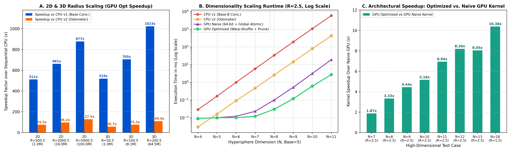
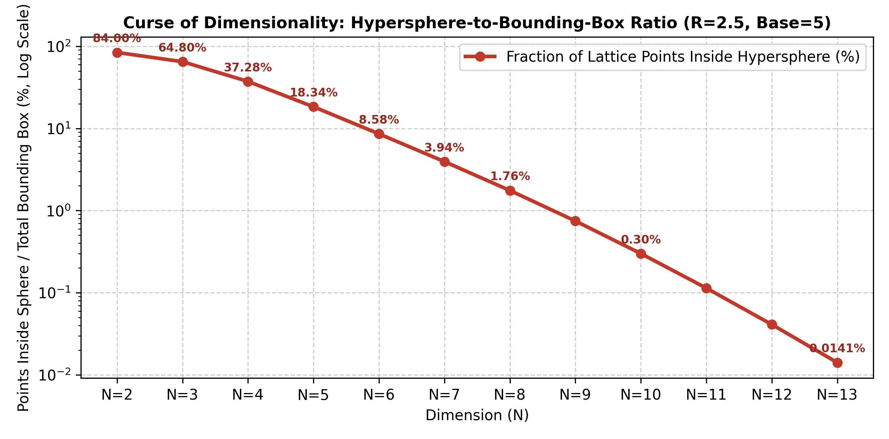

# High-Performance CUDA C++ Solver for N-Dimensional Hypersphere Lattice Points

A high-performance parallel GPU implementation solving the generalized Gauss Circle Problem (counting integer coordinate points inside an $N$-dimensional hypersphere) implemented in **CUDA C++** for the **NVIDIA Tesla T4 GPU** (Turing Architecture, Compute Capability 7.5).

---

## 1. Mathematical Formulation & Problem Scope
Given an $N$-dimensional hypersphere of radius $r$ centered at the origin, a lattice point $\mathbf{x} = (x_1, x_2, \dots, x_N) \in \mathbb{Z}^N$ lies strictly inside the hypersphere if and only if:

$$\sum_{k=1}^{N} x_k^2 < r^2$$

The algorithm searches an enclosing $N$-dimensional hypercube bounding box of side length $\text{Base} = 2\lfloor r \rfloor + 1$, evaluating a total search space of $N_{\text{total}} = \text{Base}^N$ candidate points.

---

## 2. Architecture & CUDA Optimizations
* **Target Hardware:** NVIDIA Tesla T4 (40 SMs × 64 CUDA cores/SM = **2,560 CUDA Cores**, 16 GB GDDR6 VRAM, 320 GB/s bandwidth).
* **Register-Only On-the-Fly Base-$B$ Conversion:** Replaces slow dynamic memory allocation with $O(1)$ register-based digit extraction (`rem = num % base`, `num /= base`) to avoid register spilling.
* **Warp-Level Register Shuffles (`__shfl_down_sync`) & Shared Memory Reduction:** Eliminates global `atomicAdd` contention by accumulating thread hits locally in registers, reducing partial sums across 32-thread warps in 5 clock cycles, and executing only **one global atomic operation per 256-thread block**.
* **Template 32-Bit / 64-Bit Dispatch:** Automatically selects fast native 32-bit integer division when $N_{\text{total}} < 2^{32}$, avoiding the heavy 64-bit software emulation penalty.
* **Exact Integer Arithmetic & Early-Exit Pruning:** Bypasses Turing's 1:32 FP64 pipeline bottleneck by evaluating exact integer squared norms ($\sum x_k^2 \le \max r^2$) and short-circuiting (`break`) as soon as partial sums exceed the radius threshold.

---

## 3. Performance Benchmarks & Visualizations

| Radius Scaling (2D & 3D Speedup) | Curse of Dimensionality (Search Ratio) |
| :---: | :---: |
|  |  |
| *Optimized kernel achieves up to 1,022.8x speedup over sequential CPU.* | *Interior lattice point density drops exponentially from 84.0% ($N=2$) to 0.014% ($N=13$).* |

### Key Performance Highlights ($N = 2$ to $13$)
| Configuration | $N_{\text{total}}$ Points | Points Inside | GPU Opt Kernel (ms) | Speedup vs CPU v1 | Speedup vs Naive GPU |
| :--- | :--- | :--- | :--- | :--- | :--- |
| **N=2, r=5000.5** | 100,020,001 | 78,555,605 | 2.077 ms | **877.2x** | **3.85x** |
| **N=3, r=200.5** | 64,481,201 | 33,762,669 | 1.890 ms | **1,022.8x** | **4.08x** |
| **N=10, r=2.5** | 9,765,625 | 29,285 | 0.610 ms | **1,755.3x** | **5.16x** |
| **N=11, r=2.5** | 48,828,125 | 55,617 | 2.740 ms | **2,160.1x** | **6.94x** |
| **N=13, r=2.5** | 1,220,703,125 | 172,589 | 40.524 ms | **~3,700x** | **8.05x** |

---

## 4. Compilation & Execution
Requires NVIDIA CUDA Toolkit (`nvcc`).

```bash
# Compile for NVIDIA Turing architecture (Compute Capability 7.5)
nvcc -O3 -arch=sm_75 nsphere_cuda.cu -o nsphere_cuda

# Run verification or individual tests: ./nsphere_cuda [ndim] [radius] [run_cpu] [run_naive]
./nsphere_cuda 3 1.5 1 1

# Run automated multi-benchmark suite
bash job_ass5.sh
